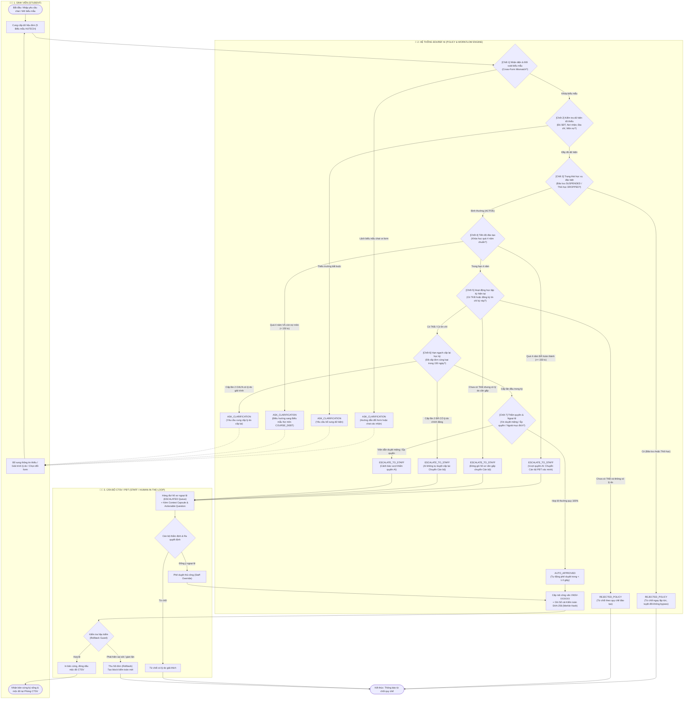

# 03. Quy Trình Nghiệp Vụ Bản Chung Kết

> Quy trình chuẩn hóa: `STUDENT_CONFIRMATION` — Cấp Giấy Xác Nhận Sinh Viên (5 Biểu Mẫu Chuẩn HUTECH).  
> Nguồn chân lý kiến trúc: [`SoDoHeThong_EduRef_AI.mdj`](file:///d:/MLAI_HACKATHON/equipment_agent/DA_CNPM/SoDoHeThong_EduRef_AI.mdj) và [`StudentConfirmationDecisionService.js`](file:///d:/MLAI_HACKATHON/equipment_agent/DA_CNPM/EDUREF_AI/backend/services/StudentConfirmationDecisionService.js).

---

## 1. Sơ đồ luồng thẩm định học vụ tự hành (Theo Sơ đồ Hệ thống `.mdj`)

---

## 2. Bốn Kết Quả Đầu Ra Chuẩn Hóa (Track A Spec Stops)

| Kết quả đầu ra | Trạng thái kỹ thuật | Ý nghĩa nghiệp vụ | Hành vi hệ thống |
| :--- | :---: | :--- | :--- |
| 🟢 **AUTO_APPROVED** | `APPROVED` | Đạt 100% điều kiện thường quy, có TKB, không trùng hạn ngạch kỳ này. | Cấp mã công văn `XNSV-XXXXXX`, chốt sổ kiểm toán SHA-256, hẹn nhận bản cứng tại CTSV. |
| 🟡 **ASK_CLARIFICATION** | `WAITING_STUDENT` | Thiếu dữ kiện, phát hiện lệch form giữa chat và UI, hoặc xin cấp lần 2 chưa có lý do. | Giữ nguyên trạng thái đơn, hướng dẫn sinh viên bổ sung thông tin hoặc chuyển đổi form. |
| 🔴 **REJECTED_POLICY** | `REJECTED` | Vi phạm quy chế đào tạo (Bảo lưu, Thôi học, không có TKB học kỳ này). | Từ chối dứt khoát, nêu rõ căn cứ điều khoản quy chế, hướng dẫn liên hệ trực tiếp CTSV. |
| 🟠 **ESCALATE_TO_STAFF** | `ESCALATED` | Vượt thẩm quyền AI (Cấp lần 2 có lý do, khóa > 4 năm đã hoàn thành CTĐT, cần gấp khi chưa có TKB, duyệt miệng). | Đóng gói Context Capsule và gửi `actionableQuestion` cụ thể lên Hàng đợi Cán bộ xử lý. |

---

## 3. Điểm Tương Tác Con Người & Khắc Phục Sự Cố (Human-in-the-Loop & Rollback)

- **Sinh viên:** Cung cấp thông tin theo 5 biểu mẫu chuyên biệt, có thể điền form nhanh bên thanh trái hoặc trò chuyện trực tiếp để AI hỗ trợ bóc tách.
- **Tác tử AI:** Tư vấn quy chế, bóc tách thực thể, phát hiện lệch biểu mẫu, thẩm định 7 chốt chặn và đề xuất quyết định học vụ an toàn.
- **Cán bộ CTSV / PĐT:** Tiếp nhận hồ sơ tại Hàng đợi Ngoại lệ (`ESCALATED Queue`), xem xét ngữ cảnh đầy đủ, phê duyệt ngoại lệ (Staff Override) hoặc từ chối có giải thích.
- **Cơ chế Rollback an toàn:** Cán bộ có toàn quyền thu hồi đơn đã tự duyệt bất kỳ lúc nào nếu phát hiện sai sót, tạo ra một block kiểm toán đối ứng mới trong Sổ cái SHA-256 mà không ghi đè hay làm mất tính toàn vẹn của lịch sử cũ.

---

## 4. Verify Harness Độc Lập

Hệ thống cung cấp các endpoint kiểm chứng độc lập:
- `POST /api/agent/verify-90s`: Chạy tự động bộ 5 ca Track A Escalation Verify (đúng tỷ lệ 3 AUTO : 2 ESCALATE).
- `POST /api/agent/verify-general`: Chạy kiểm chứng 4 nhóm quyết định học vụ tổng quát.
- `POST /api/agent/verify-custom-prompt`: Kiểm chứng ca tự do do Giám khảo nhập vào theo thời gian thực.
Mọi ca test đều gọi trực tiếp Động cơ Quy chế [`StudentConfirmationDecisionService.js`](file:///d:/MLAI_HACKATHON/equipment_agent/DA_CNPM/EDUREF_AI/backend/services/StudentConfirmationDecisionService.js), đảm bảo tính xác định tuyệt đối (Deterministic) mà không phụ thuộc vào độ trễ hay ảo tưởng của LLM.
