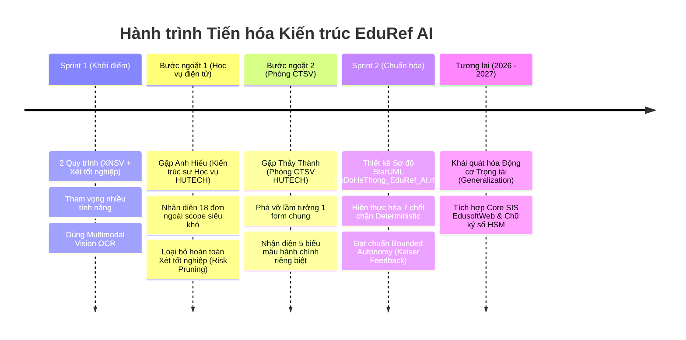

# 17. LỘ TRÌNH PHÁT TRIỂN & HÀNH TRÌNH TIẾN HÓA KIẾN TRÚC (ROADMAP & ARCHITECTURAL EVOLUTION)

> **Dự án:** EduRef AI — The Academic Escalation Referee  
> **Căn cứ thực tiễn:** Phản hồi từ Chuyên gia Đào tạo HUTECH (Anh Hiếu), Cán bộ Phòng CTSV (Thầy Thành), Ban Giám khảo VNG (Doanh nghiệp Kaiser), Sơ đồ hệ thống [`SoDoHeThong_EduRef_AI.mdj`](file:///d:/MLAI_HACKATHON/equipment_agent/DA_CNPM/SoDoHeThong_EduRef_AI.mdj) và Kế hoạch kỹ thuật [`implementation.plan`](file:///d:/MLAI_HACKATHON/equipment_agent/DA_CNPM/implementation.plan).

---

## 1. TỔNG QUAN HÀNH TRÌNH TIẾN HÓA THỰC TẾ (THE REAL EVOLUTION STORY)

EduRef AI không phải là một mô hình thử nghiệm lý thuyết, mà là sản phẩm được tôi luyện qua **hai bước ngoặt khảo sát nghiệp vụ thực tế với các chuyên sự của Trường Đại học Công nghệ TP.HCM (HUTECH)**:



---

## 2. CHI TIẾT CÁC BƯỚC NGOẶT NGHIỆP VỤ & KỸ THUẬT

### 2.1. Bước ngoặt 1 — Quyết định Cắt giảm Phạm vi Chiến lược (Strategic Scope Pruning)
* **Bối cảnh ban đầu (Sprint 1):**  
  Đội thi xây dựng song song 2 quy trình: **Đơn Giấy xác nhận sinh viên** và **Đơn Đề nghị xét tốt nghiệp** (tích hợp Gemini Vision để OCR chứng chỉ Tiếng Anh B1 và Kỹ năng mềm).
* **Khảo sát chuyên gia:**  
  Làm việc trực tiếp cùng **Anh Hiếu — Người phụ trách xây dựng Hệ thống Học vụ Điện tử HUTECH**.
* **Phát hiện quan trọng:**  
  Anh Hiếu chỉ ra rằng trong toàn bộ 18 thủ tục học vụ của trường, thủ tục "Đề nghị xét tốt nghiệp" thuộc nhóm *ngoài phạm vi (out-of-scope) siêu khó và cực kỳ nhạy cảm*:
  - Đơn phải luân chuyển qua nhiều phòng ban (Khoa chuyên môn $\rightarrow$ Phòng Quản lý Đào tạo $\rightarrow$ Phòng Khảo thí $\rightarrow$ Hội đồng Xét tốt nghiệp Nhà trường).
  - Liên quan trực tiếp đến **tính pháp lý văn bằng quốc gia** và hồ sơ lưu trữ vĩnh viễn. Bất kỳ sai số hay ảo giác nào của AI đều dẫn đến hậu quả pháp lý nghiêm trọng. Không thể để AI tự động phê duyệt dứt điểm.
* **Hành động kỹ thuật (Refactor Đợt 1):**  
  Đội thi đã đưa ra quyết định kỹ thuật dũng cảm: **Cắt bỏ hoàn toàn quy trình Xét tốt nghiệp ra khỏi phạm vi tự động hóa**, chuyển toàn bộ nguồn lực tập trung xử lý End-to-End quy trình **Giấy xác nhận sinh viên** với độ tin cậy tuyệt đối.

---

### 2.2. Bước ngoặt 2 — Thấu hiểu Nghiệp vụ Sâu từ Chuyên viên Phụ trách (Deep Domain Discovery)
* **Giả định ban đầu của đội thi:**  
  Nghĩ rằng cấp giấy xác nhận chỉ là **1 biểu mẫu đơn thuần**, còn các mục đích (Vay vốn, Nghĩa vụ quân sự, Thuế...) chỉ là lý do sinh viên tự gõ vào ô văn bản.
* **Khảo sát thực tế:**  
  Làm việc trực tiếp cùng **Thầy Thành — Cán bộ Phòng Công tác Sinh viên (CTSV) HUTECH**, người trực tiếp thụ lý và thẩm định hàng ngàn đơn sinh viên mỗi học kỳ.
* **Thông tin thực tế từ Thầy Thành:**
  1. **Không phải 1 form, mà là 5 biểu mẫu chuyên biệt:**
     - **Mẫu Vay vốn NHCSXH:** Theo chuẩn Mẫu 01/TDSV (Thông tư 27/2019/TT-NHCS), bắt buộc địa chỉ thường trú chuẩn hóa 4 cấp (Tỉnh/Huyện/Xã/Thôn).
     - **Mẫu Tạm hoãn NVQS:** Bắt buộc gửi đúng Ban Chỉ huy Quân sự cấp Xã/Phường, chỉ cấp khi sinh viên đang trong thời hạn đào tạo chuẩn.
     - **Mẫu Giảm trừ gia cảnh Thuế TNCN:** Bắt buộc ghi đúng cơ quan thuế / cơ quan chi trả thu nhập của phụ huynh.
     - **Mẫu Xác nhận nợ môn (Kéo dài tiến độ):** Dành riêng cho sinh viên học quá 4 năm, bắt buộc liệt kê danh sách môn nợ và cam kết hoàn thành.
     - **Mẫu Xác nhận chung:** Cho visa, bổ sung hồ sơ, làm vé xe buýt.
  2. **Áp lực công việc thực tế của Cán bộ:**  
     Vào các đợt cao điểm đầu năm học hoặc đợt gọi nghĩa vụ quân sự, cán bộ phải duyệt tay liên tục, mỗi đơn mất từ 3 - 5 phút đối soát CSDL đào tạo.
  3. **Đánh giá của Thầy Thành:**  
     Giải pháp AI Agent tiền thẩm định và tự động xử lý các ca thường quy hợp lệ là **cực kỳ thiết thực**, giúp giảm thiểu hơn 60% khối lượng công việc lặp lại vô nghĩa cho cán bộ, đồng thời sinh viên nhận được giấy nhanh chóng mà không phải chờ đợi kéo dài.

---

### 2.3. Bước ngoặt 3 — Chuẩn hóa Kiến trúc Toàn diện (Sprint 2 Stabilization)
Dựa trên góp ý của Thầy Thành và phản hồi chuyên môn từ Ban Giám khảo VNG (Doanh nghiệp Kaiser):
1. **Thiết kế Sơ đồ StarUML chuẩn hóa:** Xây dựng [`SoDoHeThong_EduRef_AI.mdj`](file:///d:/MLAI_HACKATHON/equipment_agent/DA_CNPM/SoDoHeThong_EduRef_AI.mdj) phản ánh chính xác luồng nghiệp vụ thực tế của trường.
2. **Kế hoạch tái cấu trúc Core:** Soạn thảo [`implementation.plan`](file:///d:/MLAI_HACKATHON/equipment_agent/DA_CNPM/implementation.plan) thống nhất mọi luồng thẩm định về một nguồn chân lý duy nhất ([`StudentConfirmationDecisionService.js`](file:///d:/MLAI_HACKATHON/equipment_agent/DA_CNPM/EDUREF_AI/backend/services/StudentConfirmationDecisionService.js)).
3. **Hiện thực hóa 7 chốt chặn nghiệp vụ:**
   - Chốt 1: Nhận diện & Đối soát lệch form (`detectCrossFormMismatch`).
   - Chốt 2: Kiểm tra dữ kiện tối thiểu (`Zero-Tolerance Input Guard`).
   - Chốt 3: Chặn đứng sinh viên Bảo lưu (`SUSPENDED`) và Thôi học (`DROPPED`) không bypass.
   - Chốt 4: Kiểm tra tiến độ 150 tín chỉ & quá 4 năm chuẩn.
   - Chốt 5: Kiểm tra hoạt động học tập / TKB kỳ này (chưa có TKB cần gấp $\rightarrow$ chuyển cán bộ).
   - Chốt 6: Kiểm tra hạn ngạch cấp lại học kỳ (150 ngày; có lý do $\rightarrow$ cán bộ quyết định).
   - Chốt 7: Kiểm tra thẩm quyền (chặn viện dẫn duyệt miệng, ép quyền).
4. **Đáp ứng nghiêm ngặt Feedback Doanh nghiệp:**
   - Khóa trần cứng `maxSteps = 5` cho ReAct Loop (chống lặp vô hạn).
   - Loại bỏ hoàn toàn dịch vụ QR bên thứ ba, bảo vệ chữ ký sống và mộc đỏ của Nhà trường.
   - Xây dựng chuỗi băm Merkle SHA-256 bất biến phục vụ kiểm toán và tính năng Rollback 1-chạm.

---

## 3. LỘ TRÌNH PHÁT TRIỂN CHI TIẾT (DEVELOPMENT ROADMAP 2026 - 2027)

```text
┌───────────────────────────────────────────────────────────────────────────┐
│ GIAI ĐOẠN 1 (Sprint 1 - 2 | 09/2026 - 10/2026): FOUNDATION & COMPLIANCE   │
│ • Hoàn thành Bounded-Autonomy Referee cho Giấy XNSV (5 biểu mẫu HUTECH).  │
│ • Khóa an ninh danh tính JWT, Zero-Trust Boundary, trần 5 bước ReAct Loop.│
│ • Verify Harness 90s độc lập, 100 test case thực tế (Zero-Regression).    │
│ • Sổ cái kiểm toán SHA-256 + Rollback 1-chạm.                             │
└─────────────────────────────────────┬─────────────────────────────────────┘
                                      │
                                      ▼
┌───────────────────────────────────────────────────────────────────────────┐
│ GIAI ĐOẠN 2 (Q4/2026 | Hậu Hackathon): GENERALIZED REFEREE ENGINE         │
│ • Khái quát hóa Động cơ Trọng tài thành Khung cấu hình (Declarative Policy│
│   Schema Engine) — Tách biệt hoàn toàn Engine và Định nghĩa Thủ tục.      │
│ • Mở rộng thêm 5 thủ tục học vụ có độ rủi ro trung bình:                  │
│   1. Đơn xin tạm hoãn thi kết thúc học phần / Phúc khảo bài thi.          │
│   2. Đơn xin cấp bảng điểm học tập tạm thời.                              │
│   3. Đơn xin miễn giảm học phí theo diện chính sách.                      │
│   4. Đơn đăng ký học vượt / Rút bớt học phần ngoài hạn.                   │
│   5. Đơn xin chuyển điểm chứng chỉ Ngoại ngữ / Tin học.                   │
│ • Triển khai Local SLM (Qwen-2.5-Coder / Llama-3.1-8B) on-premise máy chủ │
│   HUTECH nhằm bảo mật dữ liệu tuyệt đối và giảm 100% chi phí API ngoài.   │
└─────────────────────────────────────┬─────────────────────────────────────┘
                                      │
                                      ▼
┌───────────────────────────────────────────────────────────────────────────┐
│ GIAI ĐOẠN 3 (2027 | Thương mại hóa): CORE INTEGRATION & NATIONAL LINKAGE  │
│ • Tích hợp Bi-directional Webhook/API trực tiếp vào CSDL Đào tạo          │
│   EdusoftWeb và Cổng thông tin Sinh viên Portal HUTECH.                   │
│ • Tích hợp Chữ ký số tập trung (Cloud CA / HSM) cho Ban Giám hiệu & CTSV: │
│   Cấp song song Bản điện tử PDF có ký số hợp chuẩn và Bản in mộc đỏ.      │
│ • Liên thông dịch vụ công: Đối soát danh sách NVQS với BCH Quân sự Quận,  │
│   đối soát hồ sơ vay vốn với Cổng Ngân hàng Chính sách Xã hội Việt Nam.   │
│ • Nhân rộng mô hình SaaS Bounded-Autonomy cho các trường Đại học thành    │
│   viên trong Mạng lưới AI phía Nam (HCMUT, HUTECH, UEL, UTE...).          │
└───────────────────────────────────────────────────────────────────────────┘
```

---

## 4. TÓM TẮT ĐÓNG GÓP CHO BÀI BÁO CÁO CHUNG KẾT (SLIDE 5 & BUILD LOG)

Nội dung tài liệu này trực tiếp cung cấp cứ liệu thực tế xuất sắc cho bài thi Chung kết:

1. **Cho Slide 5 (Giới hạn, Rủi ro & Định hướng phát triển):**
   - **Giới hạn nhận thức rõ ràng:** AI chỉ đóng vai trò Trọng tài tiền thẩm định (Escalation Referee) và xử lý ca thường quy. AI **không bao giờ tự ý quyết định các vấn đề pháp lý trọng yếu** (đã chủ động cắt bỏ quy trình Xét tốt nghiệp sau khi tham vấn Kỹ sư trưởng Học vụ).
   - **Định hướng mở rộng:** Chuyển từ "sản phẩm đơn lẻ" sang "Khung trọng tài quy chế tổng quát (Generalizable Engine)" phục vụ toàn diện các cơ sở giáo dục đại học.
2. **Cho Nhật ký phát triển (Build Log):**
   - *Tính năng lớn nhất đã quyết định cắt giảm:* Quy trình Xét tốt nghiệp, dựa trên phân tích rủi ro pháp lý cùng Anh Hiếu (Hệ thống học vụ điện tử HUTECH).
   - *Điểm cải tiến kỹ thuật lớn nhất từ người dùng:* Tách biệt 5 biểu mẫu hành chính chuyên biệt và thiết kế cơ chế chuyển tiếp Cán bộ có câu hỏi hành động (`actionableQuestion`), dựa trên thực tế công việc của Thầy Thành (Phòng CTSV HUTECH).
