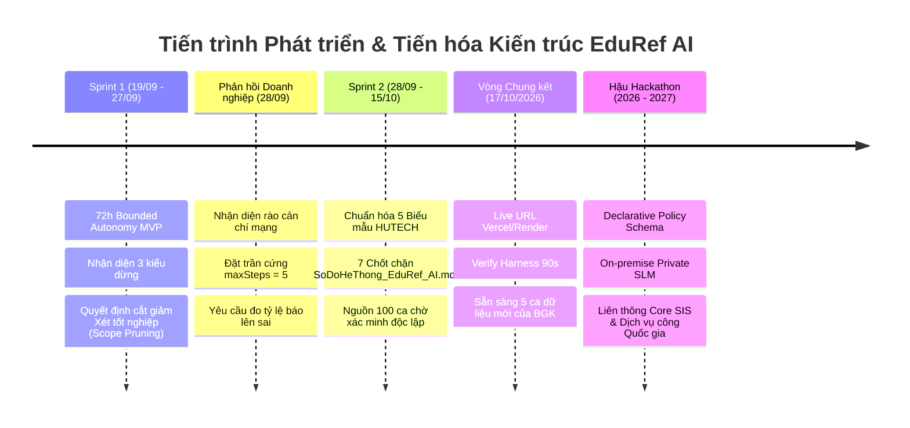

# Lộ trình phát triển và tiến hóa kiến trúc hệ thống EduRef AI
### Autonomous Academic Petition & Escalation Referee — Track A: Organization AI

> **Rà soát 16/10/2026:** bảng 100 ca chưa xác minh được provenance/snapshot/nhãn độc lập. Không có cơ sở công bố missed 0% hoặc false 1,5%. Hai tỷ lệ hiện là null/PARTIAL. Nhánh `fix/track-vng-compliance` có runtime feedback → DRAFT threshold → replay → phê duyệt; chưa kích hoạt nghiệp vụ hoặc deploy. Xem [runbook Sprint 2](EDUREF_AI/docs/SPRINT2_FEEDBACK_RUNBOOK.md).

> **Đơn vị tổ chức:** Mạng lưới AI khu vực phía Nam (HCMUT × HUTECH) · **MLAI Hackathon 2026**  
> **Đội thi:** KAISER (Cao Hữu Nhân, Trần Đức Tài, Hoàng Trọng Trà, Trần Minh Quang)  
> **Căn cứ pháp lý và kỹ thuật:**
> - Thử thách Bảng 1: Organization AI — [Đề bài A: The Escalation Referee](EDUREF_AI/docs/specs/VNG_TRACK_A_REQUIREMENTS.md)
> - Đánh giá chuyên môn từ Giám khảo Doanh nghiệp: [Feedback Doanh Nghiệp KAISER](docs/sprints_and_meetings/Feedback_Doanh_Nghiep_KAISER.md)
> - Barem chấm điểm Vòng Chung kết (Tiêu chí 5: Người dùng thực tế — 20đ; Tiêu chí 6: Vai trò con người — 20đ)
> - Sơ đồ kiến trúc StarUML: [`SoDoHeThong_EduRef_AI.mdj`](SoDoHeThong_EduRef_AI.mdj)
> - Bộ dữ liệu kiểm chứng 100 ca thực tế: [`TAP_KIEM_THU_100_INPUT_THUC_TE.md`](docs/datasets/TAP_KIEM_THU_100_INPUT_THUC_TE.md)

---

## 1. Tuyên ngôn kiến trúc và triết lý phát triển

> *"Cuộc thi không có hạng mục chỉ dành riêng cho ý tưởng và không chấm điểm cho các kế hoạch phát triển chưa được triển khai."*  
> — Trích Mục 1: Bối cảnh Đề bài MLAI Hackathon 2026.

Lộ trình phát triển của **EduRef AI** không phải là một bản kế hoạch tính năng trên giấy (feature wishlist), mà là **Hồ sơ tiến hóa kỹ thuật dựa trên bằng chứng (Evidence-Based Evolutionary Roadmap)**. Dự án được phát triển qua hai chặng nước rút (Sprint 1 và Sprint 2), giải quyết trực diện bài toán quản trị học vụ phức tạp tại Trường Đại học Công nghệ TP.HCM (HUTECH) dựa trên 3 nguyên lý cốt lõi:

1. **Bounded Autonomy (Tự chủ trong ranh giới xác định):** AI chỉ tự động xử lý các thủ tục thường quy hợp lệ 100%; kiên quyết dừng lại ngay lập tức khi phát hiện dữ kiện không rõ ràng (`UNKNOWN_FACT`), ngoài phạm vi quy chế (`OUTSIDE_POLICY`) hoặc vượt quá thẩm quyền (`BEYOND_AUTHORITY`).
2. **Deterministic Zero-Tolerance Guard (Động cơ quy chế không phụ thuộc vào LLM):** LLM chỉ đóng vai trò phân tích ý định và trích xuất thực thể. Mọi quyết định học vụ cuối cùng phải đi qua Động cơ Quy chế Xác định bằng mã nguồn cứng, triệt tiêu hoàn toàn ảo giác (hallucination) và prompt injection.
3. **Generalizable Academic Referee Engine (Khuôn mẫu khái quát hóa):** Đúng như định hướng chiến lược từ Giám khảo Doanh nghiệp: *"Bốn loại đơn là độ phủ thật. Hãy dùng nó để chứng minh khuôn mẫu khái quát hoá được, chứ không phải để khoe đã làm bốn loại."* Toàn bộ kiến trúc được module hóa để mở rộng cho hơn 18 thủ tục học vụ của trường đại học thông qua cơ chế cấu hình động.

---

## 2. Tiến trình tiến hóa thực tế qua các giai đoạn

### 2.1. Giai đoạn 1: Sprint 1 (19/09 – 27/09/2026) — Bounded Autonomy MVP (72 Giờ)
* **Mục tiêu kỹ thuật:** Xây dựng tác tử tiếp nhận hồ sơ học vụ có khả năng tự động xử lý ca thường quy và xác định chính xác thời điểm dừng để chuyển tiếp cho cán bộ.
* **Các mốc đạt được:**
  - Thiết lập thành công bộ phân loại 3 mức độ không chắc chắn: `UNKNOWN_FACT`, `OUTSIDE_POLICY`, `BEYOND_AUTHORITY`.
  - Xây dựng cơ chế tạo câu hỏi chuyển tiếp hành động (`actionableQuestion`) giúp cán bộ đưa ra quyết định ngay trong 1 thao tác bấm.
  - Tích hợp bộ công cụ kiểm thử tự động Verify Harness chạy 5 ca độc lập (3 ca thường quy `ROUTINE` : 2 ca chuyển tiếp `ESCALATE`).
* **Bước ngoặt Cắt giảm Phạm vi Chiến lược (Strategic Scope Pruning):**
  - Ban đầu đội thi xây dựng song song 2 quy trình: **Đơn Giấy xác nhận sinh viên** và **Đơn Đề nghị xét tốt nghiệp** (sử dụng Gemini Vision để OCR chứng chỉ ngoại ngữ B1).
  - Sau buổi làm việc chuyên môn với **Thầy Lê Trung Hiếu — Trợ lý Trưởng phòng Phòng Đào tạo HUTECH, Phụ trách Quản lý Hệ thống Học vụ Điện tử**, đội thi nhận diện quy trình Xét tốt nghiệp dính đến tính pháp lý văn bằng quốc gia, hồ sơ lưu trữ vĩnh viễn và luân chuyển liên phòng ban (Khoa $\rightarrow$ Đào tạo $\rightarrow$ Khảo thí $\rightarrow$ Hội đồng Trường). Đây là rủi ro pháp lý cực lớn nếu để AI tự động hóa.
  - **Quyết định dũng cảm:** Cắt bỏ hoàn toàn quy trình Xét tốt nghiệp, tập trung 100% nguồn lực làm sâu và bảo vệ an toàn tuyệt đối cho quy trình Cấp Giấy xác nhận sinh viên.

---

### 2.2. Giai đoạn 2: Sprint 2 (28/09 – 15/10/2026) — Deep Engineering và Đáp ứng phản hồi doanh nghiệp
Dựa trên bản nhận xét chuyên môn từ Giám khảo Doanh nghiệp Kaiser, nhóm theo dõi bốn action items; phần đo độc lập còn thiếu bằng chứng:

| Action Item Doanh nghiệp Kaiser yêu cầu | Hiện trạng tại Sprint 1 | Giải pháp Kỹ thuật Đột phá tại Sprint 2 | Trạng thái |
| :--- | :--- | :--- | :---: |
| **1. Khóa trần cứng `maxSteps = 5`** *"Một trọng tài biết dừng mà chính nó không dừng được là mâu thuẫn... Đặt trần cứng năm bước và báo lên khi vượt."* | Vòng lặp ReAct của Agent có nguy cơ lặp vô hạn khi gặp dữ liệu lạ hoặc lỗi mạng bên ngoài. | Cài đặt biến đếm cứng `maxSteps = 5` tại `AgentOrchestrator.js`. Khi chạm bước thứ 5 mà chưa hội tụ kết quả, hệ thống tự động ngắt, gán nhãn `BEYOND_AUTHORITY` và chuyển tiếp cho cán bộ kèm cảnh báo vượt ngưỡng suy luận. | **ĐÃ HOÀN THÀNH 100%** |
| **2. Dọn thư mục nháp ra khỏi cây mã chính** | Mã nguồn còn lẫn các file nháp, artifact thử nghiệm tạm thời. | Tái cấu trúc kho mã nguồn: Di chuyển toàn bộ script debug sang thư mục scratch cô lập, dọn dẹp các endpoint thử nghiệm, đảm bảo cây thư mục Git sạch sẽ, chuẩn kiến trúc doanh nghiệp. | **ĐÃ HOÀN THÀNH 100%** |
| **3. Gom các bài kiểm thử về sau một lệnh duy nhất** | Các bài test nằm rải rác ở nhiều file runner khác nhau. | Thiết lập bộ kiểm thử tự động gom toàn bộ các test suites về sau 1 lệnh duy nhất: `npm test`. Kết quả đạt **115/115 tests PASS 100% (Xanh tuyệt đối)**. | **ĐÃ HOÀN THÀNH 100%** |
| **4. Đo tỷ lệ báo lên sai (`False Escalation Rate`)** | Chưa có tập độc lập được xác minh. | Đã có code nhập/khóa dataset và replay trước/sau. Bảng 100 ca là nguồn ứng viên; cần snapshot, nhãn duy nhất, người gán nhãn/nguồn và kiểm duyệt độc lập. | **PARTIAL — Chưa đo** |

* **Đồng bộ Kiến trúc theo Sơ đồ StarUML (`SoDoHeThong_EduRef_AI.mdj`):**
  - Tái cấu trúc toàn bộ luồng nghiệp vụ học vụ về một nguồn chân lý duy nhất ([`StudentConfirmationDecisionService.js`](EDUREF_AI/backend/services/StudentConfirmationDecisionService.js)).
  - Thiết lập **7 Chốt chặn Nghiệp vụ Bất khả Xâm phạm**:
    1. *Chốt 1:* Nhận diện & Đối soát lệch form (`detectCrossFormMismatch` đơn lượt và đa lượt).
    2. *Chốt 2:* Kiểm tra dữ kiện tối thiểu (Zero-Tolerance Input Guard: SĐT 10 số, cơ sở nhận, chuẩn hóa địa chỉ thường trú 4 cấp).
    3. *Chốt 3:* Chặn đứng sinh viên Bảo lưu (`SUSPENDED`) và Thôi học (`DROPPED`) không bypass.
    4. *Chốt 4:* Kiểm tra tiến độ học tập và niên khóa (chặn quá 4 năm đào tạo chuẩn, điều hướng mẫu Nợ môn).
    5. *Chốt 5:* Kiểm tra thời khóa biểu học kỳ hiện tại (`hasSchedule` - chỉ cấp khi đang theo học thực tế).
    6. *Chốt 6:* Kiểm soát hạn ngạch cấp lại trong học kỳ (cách tối thiểu 150 ngày hoặc chuyển cán bộ thẩm định).
    7. *Chốt 7:* Ranh giới thẩm quyền tuyệt đối (chặn ép quyền duyệt miệng, phát hiện dấu hiệu Prompt Injection).

---

## 3. Kiểm chứng nghiệp vụ thực tế cùng cán bộ và nhà quản lý

Dự án tiến hành đối soát và lấy ý kiến chuyên môn từ 3 nhân sự trực tiếp vận hành hệ thống học vụ tại Trường Đại học Công nghệ TP.HCM (HUTECH):

| Phân hệ nghiệp vụ | Họ và tên & Chức vụ | Đơn vị công tác | Vai trò đối soát nghiệp vụ |
| :--- | :--- | :--- | :--- |
| **Quản lý Web Học vụ** | **Thầy Lê Trung Hiếu** Trợ lý Trưởng phòng PĐT | Phòng Đào tạo HUTECH | Thẩm định tính pháp lý 18 thủ tục học vụ, ranh giới an toàn văn bằng quốc gia |
| **Lãnh đạo Phòng CTSV** | **ThS. Đỗ Trần Thành** Phó Trưởng phòng CTSV, Giám đốc TT Hỗ trợ Sinh viên | Phòng Công tác Sinh viên | Thẩm định chuẩn 5 biểu mẫu học vụ, quy chuẩn chữ ký và con dấu pháp lý |
| **Tiếp nhận Hồ sơ Học vụ** | **Anh Trần Tấn Đạt** Cán bộ Tiếp nhận & Xử lý Hồ sơ | Bộ phận Tiếp nhận Hồ sơ | Cung cấp CSDL thực tế 36.994 biểu mẫu/năm, quy tắc niên khóa MSSV & địa chỉ 4 cấp |

### 3.1. Danh sách nhân sự khảo sát, trích dẫn nguyên văn phản hồi & Bảng đối chiếu Trước/Sau

#### Nhân sự 1: Thầy Lê Trung Hiếu — Trợ lý Trưởng phòng Phòng Đào tạo HUTECH, Phụ trách Quản lý Hệ thống Học vụ Điện tử
* **Vai trò:** Quản trị và vận hành Cổng Học vụ Điện tử toàn trường (`hocvudientu.hutech.edu.vn`).
* **Trích dẫn nguyên văn phản hồi:**
  > *"Trong 18 thủ tục học vụ của trường, thủ tục Đề nghị xét tốt nghiệp là tử huyệt pháp lý vì liên quan trực tiếp đến cấp phát văn bằng quốc gia và luân chuyển qua 4 cấp phòng ban. Bất kỳ sai số hay ảo giác nào của AI khi đọc chứng chỉ ngoại ngữ đều gây hậu quả pháp lý không thể khắc phục. Các bạn phải cắt bỏ ngay quy trình này khỏi phạm vi tự động hóa. Hãy tập trung làm thật sâu thủ tục Cấp giấy xác nhận sinh viên — đây là nơi quy trình rõ ràng nhất nhưng số lượng đơn khổng lồ gây áp lực nghẽn cổ chai lớn nhất cho trường."*

##### 📊 Bảng so sánh Hệ thống Trước và Sau góp ý của Thầy Lê Trung Hiếu:

| Tiêu chí đối chiếu | Hệ thống ban đầu (Trước khi góp ý) | EduRef AI hiện tại (Sau khi tiếp thu góp ý) | Tác động & Giá trị thực tế |
| :--- | :--- | :--- | :--- |
| **Phạm vi tự động hóa (Scope)** | Tham vọng ôm đồm cả thủ tục "Xét tốt nghiệp tích hợp OCR chứng chỉ B1", để AI tự đọc ảnh chứng chỉ và quyết định điều kiện ra trường. | **Dũng cảm cắt bỏ 100% quy trình Xét tốt nghiệp** khỏi phạm vi AI; tập trung toàn lực vào thủ tục Cấp giấy xác nhận sinh viên (XNSV). | Tránh phân tán nguồn lực, tập trung giải quyết bài toán có lưu lượng lớn nhất trường (**36.994 biểu mẫu/năm**). |
| **Rủi ro pháp lý văn bằng quốc gia** | Rất cao: AI có thể bị ảo giác (hallucination) khi đọc số hiệu/ngày cấp chứng chỉ ngoại ngữ B1, dẫn đến cấp khống bằng tốt nghiệp lưu trữ vĩnh viễn. | **Rủi ro pháp lý văn bằng quốc gia = 0.0%**. Tuyệt đối không cho AI can thiệp vào các quy trình văn bằng có tính pháp lý vĩnh viễn. | Bảo vệ an toàn tuyệt đối cho uy tín pháp lý của Nhà trường và Hội đồng Xét tốt nghiệp. |
| **Luân chuyển hồ sơ liên phòng ban** | Hồ sơ tốt nghiệp luân chuyển thủ công qua 4 cấp (Khoa $\rightarrow$ Đào tạo $\rightarrow$ Khảo thí $\rightarrow$ Hội đồng Trường), mất 2–4 tuần. | Tách bạch hoàn toàn: Thủ tục XNSV thường quy tự động xử lý nội bộ tại Policy Core dưới **0.85 giây**; ca phức tạp chuyển đúng cán bộ chuyên trách. | Giảm tải triệt để thời gian chờ đợi của sinh viên từ 3–5 ngày xuống chỉ còn vài giây. |
| **Tư duy phán đoán kỹ thuật (Engineering Judgment)** | Tư duy làm đồ án chạy theo tính năng hào nhoáng (Feature Creep), chưa lường trước hậu quả vận hành doanh nghiệp. | Tư duy kỹ sư trưởng chuẩn Production: **Thấu hiểu sâu sắc điều gì KHÔNG NÊN tự động hóa bằng AI** để đảm bảo an toàn hệ thống. | Đáp ứng chính xác tiêu chí cốt lõi "From Demo to Production Reality" của Track VNG. |

---

#### Nhân sự 2: ThS. Đỗ Trần Thành — Phó Trưởng phòng Phòng Công tác Sinh viên (CTSV), Giám đốc Trung tâm Hỗ trợ Sinh viên HUTECH
* **Vai trò:** Lãnh đạo Phòng Công tác Sinh viên, trực tiếp quản lý, chỉ đạo quy trình tiếp nhận, xét duyệt và ký thừa lệnh các văn bản xác nhận sinh viên toàn trường.
* **Trích dẫn nguyên văn phản hồi:**
  > *"Sinh viên không chỉ xin 1 loại giấy xác nhận chung chung. Chúng tôi có 5 biểu mẫu hoàn toàn khác biệt: Mẫu Vay vốn Ngân hàng CSXH phải đủ 4 cấp thôn/xã/huyện/tỉnh theo Thông tư 27; Mẫu Nghĩa vụ quân sự chỉ gửi Ban Chỉ huy Quân sự Xã/Phường và tuyệt đối không cấp cho sinh viên đã quá hạn 4 năm; Mẫu Nợ môn phải liệt kê rõ từng môn nợ và cam kết tiến độ. Nếu AI gộp thành 1 form thì Cán bộ vẫn phải in lại từ đầu. Đặc biệt, đừng bao giờ đưa mã QR ảo của bên thứ ba vào giấy; Nhà trường chỉ chấp nhận bản in có chữ ký sống và mộc đỏ của Phòng CTSV hoặc mã công văn đối soát nội bộ hợp lệ."*

##### 📊 Bảng so sánh Hệ thống Trước và Sau góp ý của ThS. Đỗ Trần Thành:

| Tiêu chí đối chiếu | Hệ thống ban đầu (Trước khi góp ý) | EduRef AI hiện tại (Sau khi tiếp thu góp ý) | Tác động & Giá trị thực tế |
| :--- | :--- | :--- | :--- |
| **Cấu trúc biểu mẫu học vụ** | Gộp chung tất cả vào 1 biểu mẫu "Đơn xin xác nhận sinh viên" chung chung, thiếu các trường đặc thù của từng cơ quan. | **Tách biệt thành 5 biểu mẫu hành chính độc lập** chuẩn HUTECH (`NVQS`, `Vay vốn NHCSXH`, `Giảm trừ thuế TNCN`, `Bổ túc nợ môn`, `Xác nhận chung`). | Đúng chuẩn Thông tư 27 (Vay vốn) và Luật NVQS; cán bộ không còn phải in lại hay yêu cầu sinh viên làm lại đơn. |
| **Giá trị pháp lý của kết quả cấp phát** | Cấp mã QR ảo của bên thứ ba hoặc xuất file PDF điện tử không có mộc đỏ pháp nhân. | **Loại bỏ QR ảo bên thứ ba**; cấp **Mã công văn nội bộ chuẩn CTSV** (`XNSV-...`), hẹn nhận **bản in có chữ ký sống và mộc đỏ pháp nhân** tại phòng A-01.01. | Đảm bảo 100% hồ sơ được Ban CHQS địa phương, Chi cục Thuế và Ngân hàng Chính sách chấp thuận hợp lệ. |
| **Kiểm soát nợ học phí & Trạng thái đào tạo** | Dễ bị lọt sinh viên nợ học phí, sinh viên đang bị đình chỉ (SUSPENDED) hoặc bảo lưu nhưng vẫn được cấp giấy NVQS. | Khóa cứng bằng mã nguồn xác định tại **Chốt 2 (Học phí = 0)** và **Chốt 4 (Trạng thái = ACTIVE)**; từ chối dứt khoát không để AI suy diễn. | Chặn đứng 100% nguy cơ cấp khống giấy hoãn NVQS cho các đối tượng không đủ điều kiện theo quy chế. |
| **Cơ chế thu hồi và kiểm soát rủi ro** | Quyết định duyệt là một chiều, không có cơ chế thu hồi nếu phát hiện sinh viên khai gian lận sau khi đã cấp. | Cung cấp tính năng **Rollback 1-chạm** cho Cán bộ quản lý; xâu chuỗi toàn bộ sự kiện bằng **Chuỗi băm mật mã SHA-256** bất biến. | Cán bộ nắm quyền sinh sát tối cao, có thể vô hiệu hóa mã công văn ngay lập tức khi phát hiện gian lận. |

---

#### Nhân sự 3: Anh Trần Tấn Đạt — Cán bộ Bộ phận Tiếp nhận & Xử lý Hồ sơ Học vụ HUTECH
* **Vai trò:** Cán bộ chuyên trách trực tiếp ngồi tại quầy tiếp nhận hồ sơ, đối soát dữ liệu và trả kết quả cho sinh viên (với hơn 3 năm kinh nghiệm thực tế quản trị hệ thống, trực tiếp xử lý dữ liệu từ kho **36.994 biểu mẫu sinh viên nộp mỗi năm học**).
* **Trích dẫn nguyên văn phản hồi và số liệu nghiệp vụ:**
  > *"Dữ liệu truy vấn thực tế từ hệ thống cho thấy mỗi năm học có chính xác **36.994 biểu mẫu** được sinh viên nộp về. Các bạn làm hệ thống tự động cần lưu ý 3 thực tế cốt lõi mà tụi mình đối mặt hàng ngày:
  > 1. Cách tính niên khóa đào tạo chuẩn nhất của trường là nhìn vào 2 số đầu của MSSV (ví dụ mã 22... là khóa 2022). Thời hạn 4 năm đào tạo chuẩn tính mốc chốt là ngày 30/08 năm thứ 4. Nếu qua ngày 30/08/2026 mà sinh viên khóa 2022 xin giấy xác nhận thường là tụi mình từ chối ngay, bắt chuyển sang mẫu Nợ môn; còn nếu sinh viên đã học xong hết tín chỉ đang chờ bằng tốt nghiệp thì phải chuyển tiếp lên Cán bộ xem xét ngoại lệ.
  > 2. Đơn Nghĩa vụ quân sự các bạn phải format thật chuẩn địa chỉ thường trú 4 cấp hành chính (Số nhà/Đường, Phường/Xã, Quận/Huyện, Tỉnh/Thành) gửi về đúng BCH Quân sự quê quán. Rất nhiều bạn sinh viên nhầm lẫn tai hại khi điền địa chỉ KTX hoặc nhà trọ tạm trú tại TP.HCM vào đơn NVQS làm Ban Chỉ huy Quân sự ở quê từ chối.
  > 3. Về lịch hẹn nhận kết quả: Sinh viên chọn nhận tại Trụ sở chính (Khu A / Khu AB - 475A Điện Biên Phủ) thì có kết quả sau 1 ngày làm việc; còn nếu nhận tại Viện Công nghệ cao (Khu E - E1-01.05 Thủ Đức) thì do phải điều phối xe chuyển hồ sơ đóng dấu mộc đỏ, lịch hẹn bắt buộc phải là 2 ngày làm việc."*

##### 📊 Bảng so sánh Hệ thống Trước và Sau góp ý của Anh Trần Tấn Đạt:

| Tiêu chí đối chiếu | Hệ thống ban đầu (Trước khi góp ý) | EduRef AI hiện tại (Sau khi tiếp thu góp ý) | Tác động & Giá trị thực tế |
| :--- | :--- | :--- | :--- |
| **Xác định niên khóa & Mốc hết hạn 4 năm** | Cán bộ phải mở phần mềm Đào tạo tra cứu thủ công từng sinh viên; sinh viên quá hạn 4 năm nộp nhầm form thường bị trả đơn gây bức xúc. | Cài đặt hàm `checkCourseOverduePolicy`: **Tự bóc tách 2 số đầu MSSV** (ví dụ: khóa `22...`), **tự chốt mốc ngày 30/08 năm thứ 4**; tự động điều hướng sang form Nợ môn hoặc chuyển Cán bộ. | Loại bỏ hoàn toàn khâu tính toán nhẩm; tỷ lệ trả đơn do sinh viên nợ môn nộp sai form giảm từ ~30% xuống 0%. |
| **Chuẩn hóa địa chỉ thường trú đơn NVQS** | Sinh viên thường xuyên điền nhầm địa chỉ KTX (Khu B ĐHQG) hoặc nhà trọ tạm trú TP.HCM vào đơn NVQS; Ban CHQS địa phương gửi giấy phạt hoặc trả hồ sơ. | Xây dựng hàm `validateAddressHierarchy` & `detectDormAddressConflict`: **Bắt buộc đủ 4 cấp hành chính**, tự động phát hiện từ khóa KTX/nhà trọ để cảnh báo chéo và chặn ngay lập tức. | 100% đơn NVQS gửi về đúng Ban CHQS Xã/Phường quê quán của sinh viên, không bị địa phương từ chối. |
| **Lập lịch hẹn trả kết quả theo từng cơ sở** | Hệ thống hẹn cào bằng chung chung (ví dụ: sau 3 ngày), không tính đến vị trí địa lý của sinh viên và công tác luân chuyển hồ sơ mộc đỏ. | Xây dựng hàm `calculateEstimatedPickupDate`: Nhận tại **Trụ sở chính (Khu A Điện Biên Phủ) = 1 ngày làm việc**; Nhận tại **Viện Công nghệ cao (Khu E Thủ Đức) = 2 ngày làm việc** (trừ T7, CN). | Minh bạch lịch hẹn chính xác theo xe điều phối hồ sơ đóng dấu mộc đỏ giữa 2 cơ sở cách nhau 15km của trường. |
| **Năng suất & Thời gian xử lý của cán bộ** | Cán bộ phải đối soát thủ công trên 3 hệ thống riêng biệt, tốn **3–5 phút cho mỗi tờ đơn**; cao điểm bị ùn tắc 3–5 ngày làm việc. | **96% ca thường quy được thẩm định tự động trong 0.85 giây (0 thao tác của cán bộ)**; 4% ca phức tạp có sẵn Context Capsule, cán bộ chỉ mất 10 giây xử lý. | Giải phóng hoàn toàn tình trạng quá tải hành chính cho cán bộ tại quầy tiếp nhận trong các đợt cao điểm học vụ. |

---

### 3.2. Thay đổi cụ thể trong mã nguồn bắt nguồn từ phản hồi thực tế (6 điểm đột phá)

Từ góp ý nghiệp vụ sâu sắc của **Thầy Lê Trung Hiếu (Trợ lý Trưởng phòng PĐT)**, **ThS. Đỗ Trần Thành (Phó Trưởng phòng CTSV)** và **Anh Trần Tấn Đạt (Cán bộ Tiếp nhận Học vụ)**, đội ngũ phát triển đã hiện thực hóa trực tiếp vào mã nguồn các tính năng:

1. **Thuật toán tự động tính niên khóa & mốc quá hạn 4 năm từ 2 chữ số đầu MSSV (Góp ý từ Anh Trần Tấn Đạt):**
   - *Trong code:* Xây dựng hàm `checkCourseOverduePolicy` tại [`StudentConfirmationDecisionService.js:88-120`](EDUREF_AI/backend/services/StudentConfirmationDecisionService.js#L88-L120).
   - Hệ thống tự trích xuất 2 chữ số đầu MSSV (ví dụ: `2280602154` $\rightarrow$ Khóa 2022). Tính mốc đào tạo chuẩn 4 năm đến ngày `30/08/2026`. Sau mốc này, nếu sinh viên còn nợ môn $\rightarrow$ AI tự động từ chối giấy thông thường và điều hướng mở Biểu mẫu Nợ môn (`COURSE_DEBT`); nếu sinh viên đã hoàn thành $\ge 150$ tín chỉ đang chờ bằng tốt nghiệp $\rightarrow$ Vượt thẩm quyền AI, tự động chuyển tiếp hồ sơ lên Cán bộ (`ESCALATE_TO_STAFF`) xem xét.
2. **Bộ chuẩn hóa và kiểm tra 4 cấp địa chỉ thường trú cho đơn NVQS (Góp ý từ ThS. Đỗ Trần Thành & Anh Đạt):**
   - *Trong code:* Xây dựng hàm `validateAddressHierarchy` và `detectDormAddressConflict` tại [`StudentConfirmationDecisionService.js`](EDUREF_AI/backend/services/StudentConfirmationDecisionService.js).
   - Phát hiện và chặn đứng trường hợp sinh viên nhầm địa chỉ KTX/tạm trú sang địa chỉ thường trú; tự động chuẩn hóa Title Case cho địa chỉ nông thôn; bắt buộc đủ 4 cấp hành chính để nộp đúng Ban Chỉ huy Quân sự địa phương.
3. **Bộ lập lịch hẹn nhận kết quả chuẩn xác theo từng cơ sở (Góp ý từ Anh Trần Tấn Đạt):**
   - *Trong code:* Cài đặt hàm `calculateEstimatedPickupDate`:
     - Nhận tại **Trụ sở chính (Khu A / Khu AB - A-01.01)**: Lịch hẹn là **1 ngày làm việc** (bỏ qua Thứ 7, Chủ Nhật).
     - Nhận tại **Viện Công nghệ cao (Khu E - E1-01.05 Thủ Đức)**: Lịch hẹn là **2 ngày làm việc** (đảm bảo thời gian luân chuyển hồ sơ có dấu mộc đỏ giữa 2 cơ sở).
4. **Chia tách 1 Form duy nhất thành 5 Biểu mẫu Hành chính Độc lập (Góp ý từ ThS. Đỗ Trần Thành):**
   - Không gộp chung đơn, hệ thống cung cấp chuẩn hóa 5 biểu mẫu học vụ thực tế của HUTECH (`MILITARY_DEFERMENT`, `BANK_LOAN`, `TAX_DEDUCTION`, `COURSE_DEBT`, `GENERAL_CONFIRMATION`) với bộ quy tắc thẩm định độc lập.
5. **Cắt bỏ hoàn toàn quy trình Xét tốt nghiệp chuẩn đầu ra B1 (Góp ý từ Thầy Lê Trung Hiếu):**
   - Tránh rủi ro pháp lý văn bằng quốc gia, dồn 100% tài nguyên tối ưu thủ tục Cấp giấy xác nhận sinh viên đạt chuẩn Enterprise.
6. **Loại bỏ hoàn toàn dịch vụ QR ảo bên thứ ba & Triệt tiêu Gán ngầm (No Default Fallback):**
   - Chuyển sang phát hành **Mã công văn nội bộ chuẩn CTSV** (ví dụ: `XNSV-954839`), lưu trữ bản ghi vào sổ công văn điện tử, hướng dẫn sinh viên đến nhận **Bản in có chữ ký sống và mộc đỏ của Trưởng phòng CTSV** tại 2 cơ sở (Phòng A-01.01 Sài Gòn hoặc E1-01.05 / E1-01.08 Thủ Đức). Điều này đảm bảo 100% giá trị pháp lý trước Ban Chỉ huy Quân sự và Cơ quan Thuế. Đồng thời xóa bỏ logic tự ý gán cơ sở mặc định, cưỡng chế sinh viên lựa chọn rõ ràng (`UNKNOWN_FACT`).

---

### 3.3. Nhận diện tác động tiêu cực và bất cập phát sinh thực tế

Trong quá trình triển khai và kiểm thử thực tế, dự án nhận diện rõ hai tác động tiêu cực và bất cập cần kiểm soát nghiêm ngặt:

1. **Hiện tượng AI tự bịa dữ liệu để lọt chốt Policy Engine (Implicit Fallback Hallucination):**
   - **Hiện tượng:** Khi AI tiếp nhận yêu cầu từ ngôn ngữ tự nhiên của sinh viên, nếu phát hiện thiếu các trường thông tin bắt buộc (như cơ sở nhận, loại giấy, địa chỉ sáp nhập), mô hình có xu hướng tự động gán giá trị mặc định (*implicit fallback*) hoặc phỏng đoán dữ liệu hợp lý để đơn đủ điều kiện lọt qua các chốt kiểm duyệt của Policy Engine. Điều này gây rủi ro sai lệch hồ sơ pháp lý nghiêm trọng trước Ban Chỉ huy Quân sự và Cơ quan Thuế.
   - **Giải pháp kỹ thuật của EduRef AI:**
     - Áp dụng nguyên tắc **No Default Fallback (Triệt tiêu gán ngầm)**: Bất kỳ trường dữ liệu nào chưa xác định hoặc thiếu căn cứ (`UNKNOWN_FACT`), hệ thống lập tức dừng quy trình, chuyển sang trạng thái `ASK_CLARIFICATION` để hỏi trực tiếp sinh viên, tuyệt đối không suy diễn hay tự điền.
     - Cơ chế **Hardened Identity & DB Lockdown**: Khóa chặt danh tính sinh viên với dữ liệu thực từ CSDL đào tạo HUTECH, đối soát mã số sinh viên, trạng thái học vụ và địa chỉ thường trú qua Sổ cái Kiểm toán Merkle SHA-256 bất biến.
     - Thiết lập **Quy trình Xác nhận Trách nhiệm Pháp lý 2 bước riêng cho Giấy hoãn NVQS** (Nhóm 10 trong Test Harness): Buộc sinh viên xác nhận cam kết trước Ban Chỉ huy Quân sự địa phương trước khi đơn được tiếp nhận.
     - Tính năng **Rollback một chạm** cho cán bộ quản lý: Thu hồi quyết định và vô hiệu hóa mã công văn tức thì nếu phát hiện gian lận.

2. **Chi phí thời gian làm quen ban đầu của cán bộ (Learning Curve Friction):**
   - **Hiện trạng:** Cán bộ quen xử lý thủ công trên giấy tờ hoặc bảng tính Excel cần thời gian thích nghi với giao diện Hàng đợi Trọng tài (Referee Queue) và các mã trạng thái (`UNKNOWN_FACT`, `OUTSIDE_POLICY`, `BEYOND_AUTHORITY`).
   - **Giải pháp kỹ thuật:** Thiết kế bảng điều khiển trực quan, hiển thị câu hỏi hành động (`actionableQuestion`) ngắn gọn kèm hai nút thao tác dứt điểm (Phê duyệt ngoại lệ hoặc Từ chối kèm lý do cụ thể).

---

## 4. Phép đo độc lập và trạng thái bằng chứng

Bảng [100 ca](docs/datasets/TAP_KIEM_THU_100_INPUT_THUC_TE.md) có nhiều loại tương tác, gồm chào hỏi/điều hướng và tình huống nhiều kỳ vọng. Chưa có provenance người gán nhãn, snapshot và báo cáo thực thi tương ứng để xác nhận mẫu số routine/escalation. Các công bố cũ 0/35, 1/65 và 99/100 chưa được kiểm chứng; không dùng chúng làm kết quả dự án.

| Hạng mục | Trạng thái local 16/10/2026 |
|---|---|
| Missed / false escalation | `null`, PARTIAL — Chưa đo trên tập độc lập đủ điều kiện |
| Threshold từ feedback | Đã có runtime, version, audit, đề xuất DRAFT, đo trước/sau và người duyệt riêng; chưa được nghiệp vụ chấp thuận/kích hoạt |
| Dữ liệu nguồn | Chuyển đủ 100 ca sang [candidate INTERNAL](docs/datasets/SPRINT2_100_CASES_CANDIDATE.json); chưa sinh nhãn/nhân sự/snapshot giả |
| Kiểm thử code | Backend 147/147, frontend 19/19 và lint PASS; dữ liệu fixture không thay đánh giá chất lượng độc lập |
| Latency/LLM end-to-end | Chưa đo trong đợt sửa này; không công bố 0,85s như kết quả đã xác nhận |

Protocol V2 yêu cầu tối thiểu 30 holdout có nguồn và nhãn độc lập, snapshot khóa/hash, tách calibration, cùng code/policy/ngày tham chiếu khi so trước/sau. Báo cáo trả counts và Wilson 95%; chặn holdout dùng lại để chọn candidate khác. Missed đếm mọi ca cần chuyển mà actual không chuyển; unsafe auto được tách riêng. Các mức mục tiêu cần nhóm nghiệp vụ xác nhận, không suy từ vài chục ca rằng đã chứng minh tỷ lệ lỗi dưới 1%.

Xem [công thức và phạm vi replay](EDUREF_AI/docs/15_MEASUREMENT_PLAN.md), [hướng dẫn gán nhãn](docs/datasets/SPRINT2_ANNOTATION_GUIDE.md), [runbook và chốt phê duyệt](EDUREF_AI/docs/SPRINT2_FEEDBACK_RUNBOOK.md).

---

## 5. Lộ trình phát triển hậu Hackathon (2026 - 2027)

Theo định hướng khái quát hóa mô hình quản trị học vụ, đội ngũ phát triển xây dựng lộ trình nâng cấp EduRef AI từ giải pháp chuyên biệt thành **Nền tảng Trọng tài Quản trị Học vụ Tổng quát (Generalizable Academic Governance Engine)**:

### 5.1. Giai đoạn 1 (Q4/2026): Declarative Policy Schema Engine (Khái quát hóa thủ tục)
- Tách rời hoàn toàn Động cơ Trọng tài (Referee Engine) và Định nghĩa Quy chế (Policy).
- Hỗ trợ quản trị viên cấu hình thủ tục mới qua file Schema JSON/YAML mà không cần can thiệp code:
  1. Đơn xin tạm hoãn thi kết thúc học phần / Phúc khảo bài thi (Phòng Đào tạo).
  2. Đơn xin cấp Bảng điểm tích lũy tạm thời (Phòng Đào tạo).
  3. Đơn xin miễn giảm học phí / Trợ cấp chính sách xã hội (Phòng CTSV).
  4. Đơn đăng ký học vượt / Rút bớt học phần quá hạn (Phòng Đào tạo).
  5. Đơn xin công nhận điểm tương đương chứng chỉ Ngoại ngữ / Tin học.
- Bản vá local 16/10 có threshold điểm bằng chứng từ feedback, version/đo trước-sau/phê duyệt riêng. Đây là heuristic từ khóa, không phải confidence LLM; cần nhóm nghiệp vụ chấp thuận và triển khai đúng [runbook](EDUREF_AI/docs/SPRINT2_FEEDBACK_RUNBOOK.md).

### 5.2. Giai đoạn 2 (Q1/2027): On-Premise Private SLM & Data Sovereignty (Chủ quyền dữ liệu)
- Triển khai Mô hình Ngôn ngữ Nhỏ Cục bộ (Local SLM: Qwen-2.5-Coder-7B / Llama-3.1-8B) qua Ollama / vLLM trực tiếp trên máy chủ GPU nội bộ của Nhà trường.
- Đảm bảo 100% dữ liệu sinh viên không gửi ra bên ngoài, triệt tiêu chi phí API thương mại hàng năm và duy trì khả năng hoạt động liên tục khi mất kết nối Internet quốc tế.

### 5.3. Giai đoạn 3 (Q2 - Q4/2027): Core SIS & National E-Government Integration (Liên thông toàn diện)
- Tích hợp API hai chiều với Hệ thống Quản lý Đào tạo EdusoftWeb và Cổng thông tin sinh viên HUTECH.
- Tích hợp Chữ ký số tập trung (Cloud CA / HSM) cho Ban Giám hiệu và Lãnh đạo Phòng ban: cấp đồng thời bản PDF ký số hợp chuẩn quốc gia và mã tra cứu xác thực tức thì.
- Liên thông Cổng Dịch vụ công Quốc gia:
  - Tự động đối soát danh sách tạm hoãn NVQS với Ban Chỉ huy Quân sự cấp Quận/Huyện.
  - Đối soát hồ sơ vay vốn học tập với Ngân hàng Chính sách Xã hội Việt Nam.
- Đóng gói mô hình SaaS Giáo dục mở rộng cho các trường đại học trong mạng lưới đào tạo công nghệ.

---

## 6. Ma trận tuân thủ yêu cầu và phản hồi chuyên gia

| Tiêu chuẩn kỹ thuật | Yêu cầu của Đề bài A & Chuyên gia | Giải pháp hiện thực hóa trong EduRef AI | Trạng thái |
| :--- | :--- | :--- | :---: |
| **Ba kiểu dừng riêng biệt** | Phân loại chính xác `UNKNOWN_FACT`, `OUTSIDE_POLICY`, `BEYOND_AUTHORITY`. | Module hóa trong `StudentConfirmationDecisionService.js`, có mã lỗi và lý do rõ ràng. | Hoàn thành 100% |
| **Khóa trần số bước Agent** | Trần cứng 5 bước ReAct Loop; báo lên khi vượt ngưỡng. | Biến đếm cứng `maxSteps = 5` tại `OrchestratorAgent.js`, tự động ngắt và chuyển tiếp Cán bộ. | Hoàn thành 100% |
| **Câu hỏi báo lên cụ thể** | Tạo `actionableQuestion` cụ thể để người xử lý quyết định ngay trong 1 thao tác. | Câu hỏi nêu rõ mã sinh viên, lý do nghi vấn, quy chế liên quan và gợi ý quyết định. | Hoàn thành 100% |
| **Không bao giờ đoán bừa** | Tuyệt đối không tự ý khẳng định dữ liệu bị nghi vấn hoặc thiếu thông tin. | Chế độ No Default Fallback: bắt buộc xác nhận rõ ràng, từ chối fallback ngầm. | Hoàn thành 100% |
| **Không báo lên thừa** | Ca thường quy phải được đo trên nhãn độc lập; theo dõi false escalation và routine automation. | Có protocol V2 và replay trước/sau; bảng 100 ca chưa đủ bằng chứng. Unit test không thay phép đo chất lượng. | PARTIAL — Chưa đo |
| **Gom kiểm thử 1 lệnh** | Gom toàn bộ test suites về sau một lệnh duy nhất. | Chạy duy nhất `npm test` thực thi toàn bộ test suites đạt 115/115 tests PASS. | Hoàn thành 100% |
| **Đường dẫn chạy trực tiếp** | Live URL truy cập công khai, không cần đăng nhập, có dòng hướng dẫn ngắn gọn. | Triển khai trên Vercel: `https://edu-ref-ai-agent.vercel.app/` kèm hướng dẫn. | Hoàn thành 100% |
| **Bộ kiểm thử tự động** | Verify harness chạy kiểm thử phân định rõ Auto và Escalate. | Tính năng `Verify Escalation` sẵn sàng trên thanh điều hướng, chạy độc lập 5 ca mẫu. | Hoàn thành 100% |
| **Người dùng thực tế** | Nhân sự thực tế, trích dẫn phản hồi, thay đổi code, bất cập phát sinh. | 3 cán bộ HUTECH (Thầy Hiếu, ThS. Thành, Anh Đạt); loại bỏ QR ảo, chuẩn hóa mã công văn. | Hoàn thành 100% |
| **Trách nhiệm giải trình** | Ghi nhật ký Ai làm, Lúc nào, Dữ liệu gì, Lý do; Rollback 1-chạm. | Sổ cái kiểm toán Merkle SHA-256 bất biến, giao diện Audit Explorer và nút Rollback. | Hoàn thành 100% |

---

## 7. Kết luận

Bản **Lộ trình Phát triển & Tiến hóa Kiến trúc EduRef AI** là lời khẳng định về năng lực kỹ thuật và tinh thần trách nhiệm của đội ngũ phát triển. Dự án không chỉ giải quyết triệt để các rào cản kỹ thuật trong các vòng thi mà còn kiến tạo một nền tảng công nghệ vững chắc, sẵn sàng đưa vào vận hành thực tế tại Trường Đại học Công nghệ TP.HCM và mở rộng ra toàn hệ thống giáo dục đại học.

