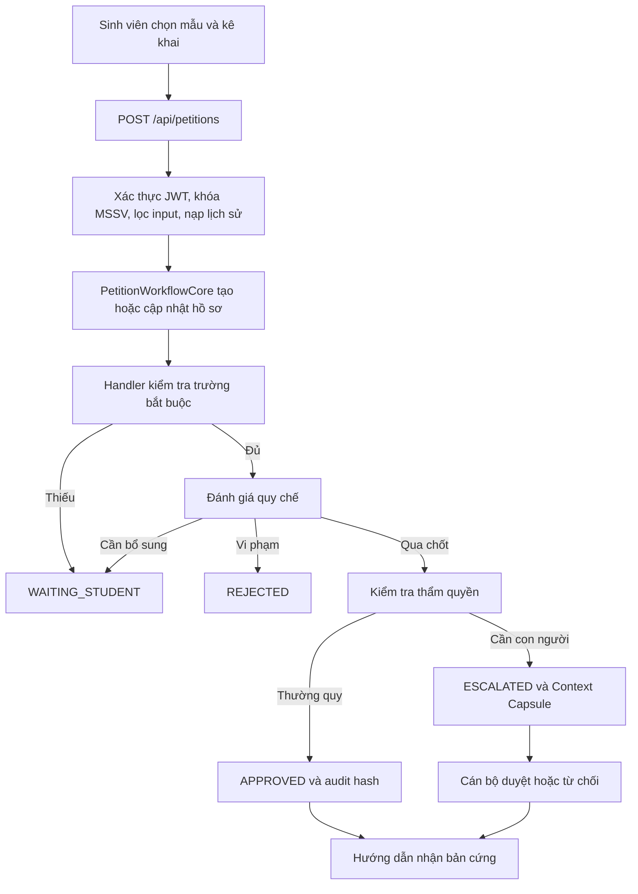

> Snapshot trước đợt dọn ngày 15/10/2026. Thứ tự chốt, giao diện lỗi 3–4 và nhiều mục cleanup đã được xử lý sau khi lập báo cáo. Xem [kết quả cập nhật](KET_QUA_DON_DEP_CODEBASE.md).

# Phân tích dự án và nghiệp vụ EduRef AI

Ngày khảo sát: **15/10/2026**, theo múi giờ Asia/Bangkok.

Phạm vi: tài liệu trong repository, sơ đồ StarUML, mã nguồn backend/frontend, Prisma schema/migration/seed và các kiểm tra cục bộ. Nhận định áp dụng cho cây làm việc hiện tại, bao gồm các thay đổi chưa commit đã có trước khi khảo sát. Đây là bản phân tích hiện trạng; không thay đổi logic sản phẩm.

Các quy định được mô tả dưới đây là **quy tắc đang được dự án mô hình hóa**. Việc đọc repository không xác nhận chúng là quy định chính thức đang có hiệu lực của HUTECH hoặc cơ quan nhà nước. Tương tự, đường dẫn triển khai và trích dẫn phỏng vấn trong tài liệu chưa được kiểm chứng độc lập trong lần khảo sát này.

## 1. Bản chất và phạm vi sản phẩm

EduRef AI xử lý việc tiếp nhận, thẩm định và điều phối **hồ sơ xin cấp giấy xác nhận sinh viên** trong tổ chức giáo dục. Giá trị chính là giảm các bước kiểm tra thường quy của cán bộ và chuyển đúng hồ sơ ngoại lệ cho con người, kèm căn cứ và câu hỏi có thể quyết định được.

Phạm vi thực thi chính hiện có một workflow: `STUDENT_CONFIRMATION`. Năm biểu mẫu là các biến thể qua `inputData.formCode`, không phải năm workflow độc lập trong database.

Quy trình xét tốt nghiệp, hoãn thi, phúc khảo và các thủ tục khác xuất hiện trong tài liệu lịch sử hoặc một số nhánh mã còn lại, nhưng không có handler được đăng ký cho chúng trong workflow chính. Việc cấp giấy xác nhận phục vụ vay vốn/NVQS cũng không đồng nghĩa hệ thống quyết định khoản vay hoặc quyết định hoãn NVQS của cơ quan bên ngoài.

Kết quả phần mềm đang cung cấp là trạng thái hồ sơ, mã `XNSV-XXXXXX`, bằng chứng audit và hướng dẫn/lịch hẹn nhận bản cứng. Mã được sinh khi tạo hồ sơ, kể cả khi hồ sơ chưa được duyệt; vì vậy **có mã hồ sơ chưa đồng nghĩa đã được cấp giấy**. Chữ ký sống và mộc đỏ thuộc bước xử lý ngoài phần mềm. Chưa thấy luồng xuất/in văn bản chính thức, ký số, phát hành PDF hoặc ghi nhận sinh viên đã nhận giấy hoàn chỉnh.

Nguồn chính: `EDUREF_AI/backend/modules/petition-core/PetitionWorkflowCore.js`, `EDUREF_AI/backend/services/StudentConfirmationDecisionService.js`, `EDUREF_AI/backend/routes/petitionRoutes.js`.

## 2. Các bên tham gia và trách nhiệm

| Bên tham gia | Công việc trong hệ thống | Giới hạn đáng chú ý |
|---|---|---|
| Sinh viên | Trao đổi với trợ lý, chọn mẫu, kê khai thông tin, gửi hồ sơ, bổ sung, theo dõi kết quả | REST và các tool gắn hồ sơ có kiểm tra danh tính/quyền sở hữu |
| AI Agent | Hiểu ngôn ngữ, giữ ngữ cảnh, gọi công cụ, diễn đạt kết quả | Quyết định nghiệp vụ nằm ở backend; vòng lặp tối đa 5 lần gọi LLM |
| Cán bộ CTSV/PĐT | Xem hồ sơ chuyển tiếp, xem Context Capsule, duyệt hoặc từ chối, thu hồi hồ sơ | Luồng quyết định thủ công chỉ nhận hồ sơ `ESCALATED` |
| DEAN/ADMIN | Có quyền truy cập các API dành cho cán bộ | Workflow xác nhận hiện chủ yếu chuyển đến `STAFF`; chưa có quy trình riêng đầy đủ cho từng cấp |
| Người kiểm thử/giám khảo | Chạy 5 ca chuẩn, nhập tình huống mới, xem audit/terminal | Verify có thể tạo hồ sơ thật trong database đang cấu hình |
| Đơn vị tiếp nhận giấy bên ngoài | Sử dụng bản giấy do trường phát hành | Chưa thấy tích hợp đối soát với ngân hàng, thuế, quân sự hoặc cổng tra cứu công khai |

Phiên demo có chuyển vai trò một chạm và tạo hồ sơ tùy biến. Các tính năng này phụ thuộc `ALLOW_DEMO_ROLE_SWITCH`; frontend hiện tự đăng nhập tài khoản demo khi khởi động. Chưa có luồng đăng nhập sinh viên production qua SSO/mật khẩu hoàn chỉnh.

## 3. Năm biểu mẫu và dữ kiện nghiệp vụ

Tất cả các mẫu dùng chung dữ liệu nhân thân; handler còn kiểm tra họ tên, MSSV, ngày sinh, giới tính, lớp và CCCD, thường lấy từ database/registry khi đầu vào thiếu. Số điện thoại, mục đích và cơ sở nhận là các trường quan trọng trong luồng thẩm định.

| Mẫu | Nhu cầu sinh viên | Dữ liệu/kiểm soát thấy trong mã hiện tại | Khoảng cách với mô tả nghiệp vụ |
|---|---|---|---|
| `TAX_DEDUCTION` | Xác nhận phục vụ giảm trừ thuế TNCN | Mục đích thuế, SĐT, cơ sở nhận, địa chỉ thường trú được kiểm tra định dạng; phát hiện xung đột với cơ quan quân sự | Chưa bắt buộc cơ quan thuế/nơi nhận bằng validator riêng |
| `BANK_LOAN` | Xác nhận tình trạng sinh viên để làm hồ sơ vay vốn | Nhận diện mục đích vay vốn; thông tin nhân thân, SĐT, cơ sở nhận | Danh mục khai báo có mồ côi/số lần làm mẫu/số lần vay/số tiền vay gần nhất, nhưng validator chưa cưỡng chế đầy đủ; địa chỉ không chịu kiểm tra chặt như thuế/NVQS |
| `MILITARY_DEFERMENT` | Xin giấy chứng nhận phục vụ hồ sơ tạm hoãn NVQS | Địa chỉ thường trú, chống dùng địa chỉ trọ/KTX, SĐT, cơ sở nhận, cờ xác nhận địa chỉ, điều kiện tiến độ | Có lỗi suy ra cờ xác nhận trong chat; chưa có cơ chế hết hạn giấy sau 30 ngày |
| `COURSE_DEBT` | Xác nhận tiếp tục học để hoàn thành các môn nợ | Handler bắt buộc danh sách môn nợ; quy tắc quá hạn đào tạo hướng người dùng sang mẫu này | Chưa kiểm tra danh sách môn với dữ liệu học phần thật; thời hạn/cam kết hoàn thành chưa được cưỡng chế; chưa chặn riêng trường hợp chưa quá hạn dùng mẫu nợ môn |
| `GENERAL_CONFIRMATION` | Xe buýt, học bổng, visa, hồ sơ học tập, việc làm | Mục đích thuộc allowlist, SĐT, cơ sở nhận và nhóm nhân thân | Mục đích ngoài allowlist chuyển cán bộ; danh mục nhận diện form và allowlist chưa hoàn toàn đồng nhất |

`HUTECH_FORMS.requiredFields` là danh mục khai báo, chưa được dùng làm schema validator thống nhất. Cần phân biệt trường được khai báo, trường có ô trên giao diện và trường thật sự bị backend bắt buộc.

Nguồn: `StudentConfirmationDecisionService.js:27`, `StudentConfirmationHandler.js:23`, `DynamicPetitionModal.jsx:47`.

## 4. Hợp đồng ra quyết định

Hệ thống phân biệt **phân loại tình huống**, **quyết định xử lý** và **trạng thái hồ sơ**:

| Phân loại | Quyết định công khai | Trạng thái khi đã lưu hồ sơ | Ý nghĩa |
|---|---|---|---|
| `ROUTINE` | `AUTO_APPROVED` | `APPROVED` | Đạt điều kiện tự động |
| `UNKNOWN_FACT` | `ASK_CLARIFICATION` | `WAITING_STUDENT` | Thiếu/sai dữ kiện, lệch biểu mẫu, cần xác nhận |
| `ROUTINE_POLICY_DENY` | `REJECTED_POLICY` | `REJECTED` | Có điều kiện từ chối xác định |
| `OUTSIDE_POLICY` | `ESCALATE_TO_STAFF` | `ESCALATED` | Quy chế chưa bao phủ hoặc vượt hạn ngạch tự động |
| `BEYOND_AUTHORITY` | `ESCALATE_TO_STAFF` | `ESCALATED` | Cần người có thẩm quyền quyết định |

Một ngoại lệ trong code là địa chỉ được xác nhận nhiều lần: phân loại vẫn là `UNKNOWN_FACT` nhưng quyết định chuyển cán bộ. Do đó giao diện/tích hợp phải đọc cả `decision` và `classification`, không suy trạng thái chỉ từ một trường.

Trong database còn có các tên quyết định như `ROUTINE_AUTO_APPROVED`, `STAFF_MANUAL_APPROVED`, `ESCALATED_PENDING`. Chúng chưa được chuẩn hóa thành một enum quyết định dùng chung.

## 5. Quy tắc hiện được thực thi

### 5.1. Trạng thái và hoạt động học tập

- Lõi quyết định từ chối `DROPPED` và `SUSPENDED` trước các kiểm tra thông thường, trừ nhánh tư vấn `isInquiry` được xét đầu tiên.
- Có lịch học/tín chỉ kỳ hiện tại là điều kiện cấp tự động. Nếu không có, hệ thống từ chối; nếu phát hiện lý do cần gấp thì chuyển cán bộ với phân loại **`BEYOND_AUTHORITY`**.
- Nợ học phí không được dùng làm điều kiện từ chối trong lõi xác nhận hiện tại. Trường `tuitionDebt` vẫn được lưu và hiển thị.
- Chưa có nhánh từ chối rõ ràng cho mọi trạng thái khác `ACTIVE`: phép thử với `INACTIVE` nhưng có lịch học vẫn được duyệt. Đây là điểm cần chốt lại nghiệp vụ.

### 5.2. Quá hạn đào tạo và tiến độ

- Năm nhập học được bóc từ hai chữ số đầu MSSV; nếu không xác định được có fallback về năm 2022.
- Mốc quá hạn được tính sau **30/08 của năm nhập học + 4**, lúc 23:59:59.999 theo thời gian local của tiến trình.
- Quá hạn và còn thiếu khối lượng đào tạo: hướng sang `COURSE_DEBT`. Khi đã có `formCode` khác, cơ chế mismatch thường trả `ASK_CLARIFICATION` trước nhánh từ chối quá hạn.
- Quá hạn và đã hoàn thành từ 150 tín chỉ hoặc trạng thái `GRADUATED`: chuyển cán bộ, nếu không bị một chốt trước đó chặn.
- Code dùng nhiều fallback tín chỉ, có cả `enrolledCredits` để suy khối lượng hoàn thành. Đây là hai đại lượng nghiệp vụ khác nhau, cần tách riêng.

### 5.3. Cấp lại và trùng hồ sơ

- “Một học kỳ” hiện được xấp xỉ bằng cửa sổ trượt **150 ngày**, không tra bảng học kỳ.
- Tính cùng biểu mẫu bằng `formCode`; tính vào hạn ngạch các hồ sơ `APPROVED`, `COMPLETED` và cả `ESCALATED`.
- Xin lại mà chưa nêu lý do: hỏi bổ sung. Đã có lý do: chuyển cán bộ.
- REST nạp lịch sử từ DB và loại các khóa hạn ngạch/ngày xét duyệt do client tự gửi. Agent cũng có bước lọc input.
- Core tái sử dụng hồ sơ đang mở theo **sinh viên + loại workflow**, chưa phân theo biểu mẫu. Fast path chat lại truyền `forceNewRequest: true`. Hai đường vào có thể tạo hành vi khác nhau khi sinh viên đang có nhiều nhu cầu hoặc nhiều hồ sơ chờ.

### 5.4. Địa chỉ, mục đích và cơ sở nhận

- Nhận diện lệch biểu mẫu trong một lượt và từ hội thoại gần nhất; câu chủ động đổi ý có thể cho phép chuyển mẫu.
- Địa chỉ thuế/NVQS được kiểm tra bằng regex, số thành phần và cách viết hoa; đây là kiểm tra cấu trúc, không phải xác minh địa giới hay hộ khẩu thật.
- NVQS có thiết kế yêu cầu sinh viên xác nhận lại địa chỉ và trách nhiệm khai báo.
- Cơ sở nhận trong mã hiện tại: A-01.01 và **E1-01.05**. Một số tài liệu ghi E1-01.08.
- Scheduler tính bằng buổi làm việc, bỏ Chủ nhật và chiều thứ Bảy; chưa thấy lịch ngày lễ hoặc cố định múi giờ nghiệp vụ. Con số mô tả “1/2 ngày” không đồng nghĩa luôn cộng đúng 24/48 giờ.

## 6. Các luồng xử lý xuyên suốt

### A. Nộp biểu mẫu trực tiếp

Sơ đồ mô tả pipeline backend. Nút nộp trực tiếp trên frontend đang có lỗi hợp đồng multipart, được nêu ở mục 10; chưa thể xem sơ đồ này là bằng chứng luồng UI chạy trọn vẹn.

### B. Chat AI

`StudentWorkspacePage → Socket.IO client_send_message` hoặc HTTP `/agent/chat` → nạp danh tính → `AgentOrchestrator` → chuẩn hóa ngôn ngữ/lịch sử → Gemini function calling → `ToolResolver` → `workflowTools` → `AcademicWorkflowService` → Core/Policy → kết quả.

Tool chính là `process_student_confirmation`, gom nhiều bước trong một lần gọi. Các tool nhỏ như tạo đơn, kiểm tra requirement, kiểm tra policy/thẩm quyền và xử lý đơn vẫn còn hoạt động; kiến trúc chưa hợp nhất mọi đường đi về một pipeline hoàn toàn.

Agent tối đa 5 vòng gọi LLM. Text được stream về giao diện; kết quả cuối có thể được chỉnh nếu phát hiện LLM nói đã duyệt trong khi tool trả hỏi bổ sung/từ chối/chuyển tiếp. Guard này dùng mẫu regex và xảy ra ở kết quả cuối, nên không bảo đảm mọi phát ngôn stream đều đã được kiểm tra trước khi hiển thị.

### C. Bổ sung hồ sơ

API `/petitions/:id/resume` kiểm tra chủ hồ sơ và yêu cầu trạng thái `WAITING_STUDENT`, hợp nhất dữ liệu mới với dữ liệu cũ, lưu tài liệu mới ở `PENDING`, rồi chạy lại Core.

Tuy nhiên, fast path chat có nhiều lần trả hỏi bổ sung ngay trước khi tạo hồ sơ; những phản hồi này có thể không có `requestId`. Bổ sung tiếp bằng chat dựa vào hội thoại, không phải lúc nào cũng resume cùng một bản ghi. Giao diện upload bổ sung còn gắn dữ liệu mẫu vay vốn và URL kho giả định, chưa phải quy trình upload/lưu file thật.

### D. Cán bộ xử lý ngoại lệ

Hàng đợi lấy `StudentRequest.status = ESCALATED`. Context Capsule chứa mã hồ sơ, sinh viên, loại yêu cầu, lý do, câu hỏi hành động và tóm tắt học vụ. API approve/reject yêu cầu `STAFF/DEAN/ADMIN`; từ chối qua REST bắt buộc lý do.

`staffDecision` kiểm tra trạng thái, ghi ghi chú/người duyệt/thời điểm và dùng compare-and-set `updateMany(status = ESCALATED)` trong transaction cùng audit. Điều này chống hai người quyết định cùng lúc. Luồng `/agent/staff-confirm` dùng implementation riêng, chưa cập nhật capsule giống hệt luồng trên.

### E. Thu hồi

“Rollback” trong sản phẩm là **thu hồi/hủy**, không tua trạng thái về như chưa từng duyệt: đổi sang `CANCELLED`, ghi lý do và audit mới, giữ lịch sử. Mã QR hiện được để `null` ngay từ đầu, nên thông báo “vô hiệu hóa QR” còn mang dấu vết thiết kế cũ. Dừng sinh câu trả lời AI và thu hồi hồ sơ là hai thao tác riêng; bấm dừng không tự hoàn tác giao dịch đã commit.

## 7. Kiến trúc và mô hình dữ liệu

Frontend: React 18, Vite, Tailwind, Axios, Socket.IO client; các màn hình chính là Student Workspace, My Petitions, Staff Escalation, Verify Harness và Audit Explorer.

Backend: Node.js/Express, JWT/bcrypt, Socket.IO, Prisma/PostgreSQL. Gemini dùng SSE và function calling; model mặc định trong code là alias `gemini-flash-lite-latest`, có thể đổi bằng biến môi trường. Không thể suy phiên bản model cố định chỉ từ tên gọi trong README.

| Nhóm dữ liệu | Các bảng | Trách nhiệm |
|---|---|---|
| Tổ chức và người dùng | `Department`, `Student`, `User` | Khoa, danh tính sinh viên, cán bộ và vai trò |
| Danh mục quy trình | `RequestType`, `Requirement`, `Policy`, `AuthorityRule` | Metadata, yêu cầu và phân quyền theo loại thủ tục |
| Hồ sơ | `StudentRequest` | Trạng thái, dữ liệu kê khai JSON, lý do chuyển tiếp, capsule, hash bằng chứng |
| Minh chứng | `RequestDocument` | Metadata file, URL, dữ liệu trích xuất và trạng thái kiểm tra |
| Kiểm toán | `AuditLog` | Sự kiện, chủ thể, snapshot, trước/sau, thời gian và liên kết hash |

Đối với workflow chính, quy chế thực thi nằm trong JavaScript, chưa phải bộ máy đọc tùy ý `Policy.ruleDefinition` từ DB. Chỉnh dữ liệu Policy trong DB không mặc nhiên thay đổi logic quyết định.

Các dữ kiện `admissionYear`, `hasSchedule`, `enrolledCredits`, `completedCredits` chưa có trong model `Student`. Code sử dụng `STUDENT_REGISTRY` cho tài khoản mẫu; HTTP chat còn suy lịch học từ trạng thái và gán tín chỉ mẫu. Vì vậy chưa có kết nối SIS/TKB học kỳ thật đủ để vận hành quy chế trên sinh viên bất kỳ.

Memory hội thoại lưu RAM, TTL 2 giờ, tối đa 200 tin/phiên; lịch sử đưa vào LLM mặc định lấy 10 tin gần nhất. Có phân vùng session theo chủ thể nhưng restart máy chủ sẽ mất memory. Chưa thấy Redis, RAG, VectorDB hoặc LLM chạy nội bộ trong runtime hiện tại.

## 8. Audit và trách nhiệm giải trình

`AuditLogService` tạo chuỗi SHA-256 liên tiếp, chuẩn hóa JSON bằng cách sắp khóa, serialize hàng đợi ghi trong một Node process. Các quyết định chính của Core ghi audit và mutation trạng thái trong cùng transaction.

Hash bao phủ: hash trước, `actorType`, action, decision, reason, `inputSnapshot`, timestamp. Các cột khác như `actorId`, `requestId`, `beforeState`, `afterState` không trực tiếp nằm trong công thức hash. Vì thế xác minh chuỗi không đồng nghĩa xác minh toàn bộ dữ liệu nghiệp vụ hoặc mọi thuộc tính log.

Định danh chính xác là **hash chain giúp phát hiện một số dạng sửa đổi**, không phải chữ ký số của trường, blockchain có đồng thuận hay Merkle tree. Có hàm `reconcileChain()` tính lại chuỗi; chưa thấy endpoint công khai gọi hàm này. Không thể xem cơ chế là bất biến tuyệt đối trước người nắm toàn quyền database và mã nguồn.

Giới hạn khác: mutex chỉ trong process, chưa khóa ghi liên replica; không phải mọi phản hồi sớm hoặc tool invocation đều tạo audit nghiệp vụ; một số log chỉ có vai trò/tên trong snapshot, chưa liên kết đầy đủ tài khoản qua `actorId/userId`.

## 9. Độ khớp giữa tài liệu và thực thi

| Chủ đề | Nội dung khác nhau trong repository | Hiện trạng nên dùng để hiểu hệ thống |
|---|---|---|
| Nợ học phí | README có trần 10 triệu; seed Policy yêu cầu nợ bằng 0; policy mới bỏ chặn | Lõi quyết định hiện không từ chối vì nợ học phí |
| Phiên bản policy | Tài liệu ghi `STUDENT_CONFIRMATION_V2.0.0` | Hằng số runtime là `HUTECH_CTSV_5FORMS_V2.0.0` |
| Chưa có TKB nhưng cần gấp | Một số bảng ghi `OUTSIDE_POLICY` | Code trả `BEYOND_AUTHORITY` |
| Quá hạn nhưng nợ môn | Tài liệu có nơi ghi từ chối | Khi có mẫu khác đang chọn, mismatch thường hỏi làm rõ/chuyển mẫu trước |
| Thời hạn NVQS | Tài liệu ghi hiệu lực 30 ngày | Chưa có `expiresAt` hoặc chốt hết hạn tương ứng |
| Cơ sở Thủ Đức | Có E1-01.08 và E1-01.05 | Code chính dùng E1-01.05; địa điểm thực tế cần đơn vị nghiệp vụ xác nhận |
| QR và chữ ký | Một số API docs/UI còn nói cấp QR, chứng thực số | Luồng chính trả `qrCodeUrl: null`; hash không phải chữ ký số |
| General Verify 4 ca | README/runbook/API docs mô tả | Không có route `/api/agent/verify-general` trong mã hiện tại |
| Benchmark | ROADMAP nêu 0% bỏ sót, 1,5% báo lên thừa | API hiện trả `null`, `measurementStatus: PARTIAL`; chưa tìm thấy artifact đo độc lập tái lập được |
| Automation rate | Tên chỉ số là tỷ lệ tự động | Công thức API lấy mọi hồ sơ APPROVED / tổng hồ sơ, có thể tính cả hồ sơ cán bộ duyệt |

Tài liệu phản hồi doanh nghiệp giải thích đúng định hướng: thêm trần 5 bước, tập trung một thủ tục, đo tác động và chất lượng chuyển tiếp. Các trích dẫn người dùng và mục tiêu tiết kiệm 70–80% trong proposal/roadmap cần tách khỏi số liệu đã đo.

## 10. Những khoảng trống đáng ưu tiên

1. **Nộp trực tiếp không khớp định dạng request.** `DynamicPetitionModal.jsx:379` tạo FormData/multipart; `server.js` chỉ dùng JSON/urlencoded, không có parser multipart. Probe với cùng nội dung cho thấy JSON giữ mục đích, multipart làm mất mục đích và SĐT dù HTTP vẫn 200. Cần thống nhất payload cho luồng 5 mẫu thuần thông tin.

2. **Xác nhận địa chỉ NVQS bị nhận nhầm ngay lượt đầu.** `AgentOrchestrator.js:303` tìm từ “xác nhận” trong toàn bộ văn bản người dùng để đặt `isAddressConfirmed`. Câu “Em xin giấy xác nhận để tạm hoãn nghĩa vụ quân sự” đã khớp, dù LLM gửi cờ false. Probe xác nhận orchestrator chuyển thành true. Cần xác nhận gắn với câu hỏi trước đó và đúng phiên bản địa chỉ, không suy từ cụm tên giấy.

3. **Chạm trần Agent chưa bàn giao hồ sơ thật.** Nhánh `MAX_STEPS_EXCEEDED_ESCALATE` ghi audit không gắn request và trả object ESCALATED, nhưng không tạo/cập nhật StudentRequest. Probe cho kết quả chuyển tiếp, `requestId = null`, số lần ghi hồ sơ bằng 0. Nhánh Vision lỗi có cách trả tương tự. Cần phân biệt dừng tự động hóa với bàn giao thành công vào hàng đợi.

4. **Migration chưa theo kịp schema.** Migration duy nhất tạo bảng Student thiếu các cột nhân thân mới có trong schema như birthDate, gender, studentClass, major, idCard và permanentAddress. Dựng DB trống bằng `migrate deploy` theo runbook chưa tái lập đủ schema hiện tại. `prisma validate` chỉ xác nhận cú pháp, không xác nhận migration khớp hoặc DB triển khai đủ cột.

5. **Thiếu nguồn dữ liệu học vụ thật.** Schema chưa lưu lịch học/tín chỉ/tiến độ; không thấy connector SIS. Điều kiện 4 năm/150 tín chỉ và lịch học chưa đủ căn cứ để áp dụng production cho toàn bộ sinh viên. Cần tách tín chỉ kỳ hiện tại và tín chỉ tích lũy, cùng kỳ học/ngành/chương trình đào tạo.

6. **Chưa có validator thống nhất cho 5 mẫu.** Thiếu cơ quan thuế vẫn có thể được duyệt; các trường riêng của vay vốn và cam kết nợ môn chưa được cưỡng chế đầy đủ. Probe xác nhận đơn thuế không có `recipientAgency` vẫn AUTO_APPROVED. Các trạng thái như INACTIVE cũng cần quy tắc rõ ràng.

7. **Các đường vào khác nhau về thứ tự chốt và vòng đời.** Fast path chặn DROPPED/SUSPENDED trước khi tạo hồ sơ; Core kiểm tra requirements trước policy. Hồ sơ thiếu dữ kiện của sinh viên thôi học có thể được hỏi bổ sung ở đường Core, dù fast path từ chối ngay. Chat tạo mới cưỡng bức; Core REST tái dùng hồ sơ theo workflow. Cần một hợp đồng chung về ưu tiên chốt, idempotency và resume.

8. **Luồng bổ sung trên UI còn dùng dữ liệu giả định.** `StudentWorkspacePage` gán mục đích vay vốn, cờ có tài liệu và URL storage từ tên file; chưa upload nội dung file thật. Đây cũng là di sản lệch phạm vi 5 mẫu không yêu cầu minh chứng.

9. **Verify chưa chứng minh mọi quy tắc của giao dịch thật.** Suite gọi Core trực tiếp với fixture, bỏ qua các bước chuẩn hóa/nạp lịch sử của REST/chat. Ba ca AUTO không có formCode rõ ràng; ca vay vốn có thể chạy như GENERAL_CONFIRMATION. Ca cấp lại dùng count khai báo sẵn. Test 15 ca còn bổ sung defaultStudent khác với dữ liệu DB. Kết quả PASS ở đây không chứng minh payload UI hoặc hạn ngạch dựa DB hoạt động trọn vẹn.

10. **Hậu xử lý giấy và đo lường chưa khép kín.** Chưa có bước lập văn bản/in/ký/đóng dấu/giao nhận/hết hạn được theo dõi; chỉ số automation chưa tách AI/cán bộ, và benchmark thiếu tập độc lập có nhãn. Đây là các bước cần có trước khi tuyên bố hoàn thành toàn bộ quy trình tổ chức.

Các mục trên là căn cứ cho công việc tiếp theo, chưa được sửa trong đợt đọc dự án này. Không suy từ đó rằng mọi đường triển khai đều đã tái hiện cùng lỗi; probe sử dụng môi trường và phụ thuộc giả lập được mô tả bên dưới.

## 11. Kiểm chứng đã thực hiện

| Kiểm tra | Kết quả | Giới hạn |
|---|---|---|
| 12 file test backend có thể chạy cô lập | **109/109 test PASS**, khoảng 4,66 giây theo Node test runner | Gồm parent/subtest do runner đếm; không phải 109 hồ sơ thực tế hoặc xác nhận 100 ca NLU qua Gemini |
| Frontend `npm run build` | **PASS**, Vite build thành công | Không thay thế kiểm thử trình duyệt end-to-end |
| Prisma `validate` | **PASS** | Không kết nối để xác minh schema DB và không xác nhận migration đồng bộ |
| Probe JSON/multipart trên Express cục bộ | JSON giữ dữ kiện; multipart mất dữ kiện | Core và DB đã stub; kiểm tra hợp đồng parser, không cấp hồ sơ thật |
| Probe General Verify | **404** | Trên route hiện có trong source |
| Probe policy nợ 15 triệu | `AUTO_APPROVED` khi điều kiện còn lại đủ | Chỉ kết luận nợ học phí không phải chốt từ chối hiện tại |
| Probe policy INACTIVE có lịch học | `AUTO_APPROVED` | Xác nhận thiếu chốt riêng cho trạng thái này |
| Probe policy thuế thiếu nơi nhận | `AUTO_APPROVED` | Kiểm tra trực tiếp lõi quyết định |
| Probe Agent chạm 5 bước | Trả ESCALATE, ghi 1 audit, không ghi hồ sơ | LLM/tool/audit/DB đã stub; không dùng dịch vụ ngoài |
| Probe lượt chat NVQS đầu tiên | Cờ false từ LLM thành true ở orchestrator | LLM và tool đã stub để quan sát dữ liệu truyền |

Các test được preload `testSupport/securityTestEnv.js` để khóa DB về địa chỉ loopback không phục vụ và dùng khóa Gemini giả; các dịch vụ cần thiết được stub. Không chạy seed, migration deploy, reset dữ liệu, Verify ghi dữ liệu thật hoặc gọi Gemini thật.

Hai file `workflow-unification.test.js` và `master-flow-matrix.test.js` có đường truy cập database thật, bao gồm tạo hồ sơ, nên không chạy trong đợt đọc này. Không thể công bố toàn bộ `npm test` đã PASS hoặc live demo đã hoạt động chỉ từ kết quả trên.

## 12. Bản đồ mã nguồn để tiếp tục làm việc

| Nội dung cần hiểu/sửa | Điểm vào |
|---|---|
| Quy tắc và phân loại | `EDUREF_AI/backend/services/StudentConfirmationDecisionService.js` |
| Trường bắt buộc và quyền của workflow | `EDUREF_AI/backend/modules/petition-core/handlers/StudentConfirmationHandler.js` |
| Vòng đời hồ sơ, mutation và resume | `EDUREF_AI/backend/modules/petition-core/PetitionWorkflowCore.js` |
| Fast path, lịch sử, cán bộ quyết định, thu hồi | `EDUREF_AI/backend/services/AcademicWorkflowService.js` |
| Vòng lặp AI, giới hạn, xử lý kết quả | `EDUREF_AI/backend/modules/ai-agent/core/AgentOrchestrator.js` |
| Khai báo và dispatch công cụ | `EDUREF_AI/backend/modules/ai-agent/tools/ToolRegistry.js`, `ToolResolver.js`, `actions/workflowTools.js` |
| Tiếp nhận REST và quyền sở hữu | `EDUREF_AI/backend/routes/petitionRoutes.js`, `agentRoutes.js` |
| Socket, stream và dừng Agent | `EDUREF_AI/backend/server.js`, `modules/ai-agent/llm/GeminiStreamClient.js` |
| Audit | `EDUREF_AI/backend/services/AuditLogService.js`, `routes/auditRoutes.js` |
| Danh tính demo và nguồn hồ sơ mẫu | `EDUREF_AI/backend/controllers/authController.js`, `config/studentRegistry.js` |
| Schema, migration, dữ liệu mẫu | `EDUREF_AI/backend/prisma/` |
| Nộp mẫu và chat | `EDUREF_AI/frontend/src/components/forms/DynamicPetitionModal.jsx`, `pages/StudentWorkspacePage.jsx` |
| Duyệt ngoại lệ, hồ sơ, kiểm chứng | `EDUREF_AI/frontend/src/pages/StaffEscalationPage.jsx`, `MyPetitionsPage.jsx`, `VerifyHarnessPage.jsx`, `AuditExplorerPage.jsx` |
| Định hướng và căn cứ nghiệp vụ trong repo | `EDUREF_AI/docs/14_TRACK_A_POLICY.md`, `docs/sprints_and_meetings/`, `proposal.md`, `SoDoHeThong_EduRef_AI.mdj` |

Để phát triển tiếp, cần chốt trước nguồn dữ kiện học vụ, trường bắt buộc từng mẫu, thứ tự ưu tiên từ chối/hỏi/chuyển tiếp, cách đếm cấp lại theo học kỳ và trách nhiệm phát hành bản giấy. Sau đó thống nhất các đường REST/chat/resume/Verify trên cùng hợp đồng và kiểm chứng xuyên suốt với database thử nghiệm riêng.
